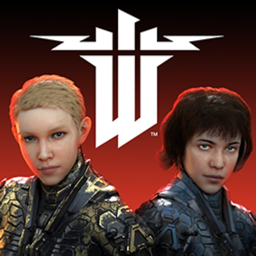
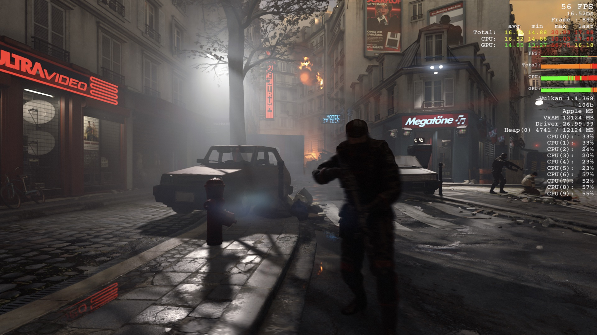

# Wolfenstein Youngblood Recomp

**Wolfenstein Youngblood Recomp** is a native Apple Silicon port of **Wolfenstein: Youngblood** (MachineGames and
Arkane Lyon, 2019), made by statically recompiling the original Windows release.

Wolfenstein: Youngblood never had a Mac version. Wolfenstein Youngblood Recomp translates the game's own 64-bit
Windows executable, function by function, into C and compiles it for arm64, so id Tech 6 runs natively on macOS,
with no Wine, no Rosetta and no x86 emulation at run time. The engine and game code run unchanged; the parts that
talked to Windows (windows and input, files, threads, audio, networking, Steam) are replaced with native
implementations, and the game's Vulkan renderer runs on Metal through
[KosmicKrisp](https://docs.mesa3d.org/drivers/kosmickrisp.html), Mesa's Vulkan driver for Apple GPUs.

This is an unofficial community project. It is not affiliated with or endorsed by MachineGames, Arkane, Bethesda or
ZeniMax. **You need your own copy of the game**: none of the game's code or data files are included in this
repository or in its downloads.

## Playing on macOS

  1. Install the **Windows** version of **Wolfenstein: Youngblood** from Steam: with Steam for Mac and a
     compatibility tool (see Steam Play below), or with Steam for Windows in
     [CrossOver](https://www.codeweavers.com/crossover) or Whisky. Make sure the game is fully downloaded and
     updated.
  2. Download `Wolfenstein-Youngblood-Recomp-macOS.dmg` from the Releases page.
  3. Open it and run **Install Wolfenstein Youngblood Recomp**. The installer finds your copy of the game, checks
     that it is the supported release, and builds the game on your Mac. The build takes about 15 to 20 minutes,
     needs about 4 GB of temporary disk space, an internet connection and Apple's Command Line Tools (the
     installer offers to install them).
  4. Launch **Wolfenstein Youngblood** from your Applications folder.

Note: release builds are not notarized by Apple yet, so macOS blocks the installer the first time it is opened.
To allow it, go to **System Settings > Privacy & Security** and click **Open Anyway**.

Some things worth knowing:
  - Settings are stored in `~/Library/Application Support/youngblood-recomp`. The game data is read from your
    installation of the game, which is never modified.
  - Saved games go to the game's Steam Cloud folder, shared with the Windows version: Steam syncs them when the
    game is started through NightSight Recomp (below). `YOUNGBLOOD_LOCAL_SAVES=1` keeps saves in the app's own
    folder instead.
  - Steam sign-in, achievements and stats work when the Steam for Mac client is running and logged in. The port
    uses the copy of Valve's `libsteam_api.dylib` that comes with the Steam client, so nothing else needs to be
    installed; without Steam, the game runs offline.
  - The game signs in to Bethesda.net through your Steam account (profile, friends and the in-game shop), as it
    does on Windows.
  - The fullscreen resolutions in the game's Video settings are scaled to your screen. A MacBook's own shape
    (20:13, for example 1720 x 1118) is listed under the **3:2** aspect ratio: the game names each resolution
    after the nearest ratio it knows, but renders at the exact size chosen.

### Steam Play (optional, needs NotProton)

Steam for Mac has the same compatibility-tool support as Steam on Linux, but it is switched off.
[NotProton](https://github.com/NotProtonNot/NotProton) switches it on. With NotProton installed, the installer's
**Steam Play: NSR** option (off by default) registers the game with **NightSight Recomp (NSR)**, the one Steam
Play tool all NightSightProductions ports share. Restart Steam, then choose it under **Wolfenstein: Youngblood >
Properties > Compatibility > Force the use of a specific Steam Play compatibility tool > NightSight Recomp
(NSR)**. Steam then installs the Windows release in its Mac library, and Play on the game's own library entry
starts Wolfenstein Youngblood Recomp, with Steam Cloud saves, the Steam overlay and playtime as for any Steam game.
CrossOver or Whisky isn't needed in that setup.

Leave the game's Steam launch options empty: with a tool other than NotProton's own, Steam for Mac can't start a
launch that has them ("OS Error 260"). Settings for the game go into NSR instead, for example
`python3 framework/tools/nsr.py set-env --appid 1056960 NAME=value` (with no values, it clears them). From a
source build, `make steam-play` registers `build/Wolfenstein Youngblood.app` (pass `APP_PATH=...` for an
installed one).

NSR lives in `~/Library/Application Support/Steam/compatibilitytools.d/nsr`, and each launch is logged to
`~/Library/Logs/nsr.log`. The uninstaller removes this game's entry and keeps the tool for other games.

## How It Works

Wolfenstein Youngblood Recomp is built on
[Recomp-Framework](https://github.com/NightSightProductions/Recomp-Framework), NightSightProductions' static
recompiler, included as the `framework/` submodule (clone with `git clone --recursive`, or run
`git submodule update --init`).

  - The executable ships wrapped in SteamStub (v3.1, with its code section encrypted). `tools/unwrap_steamstub.py`
    restores the original executable locally before anything else reads it.
  - The framework's translator (`framework/tools/recomp64.py`) reads the executable (`Youngblood_x64vk.exe`) and
    its two code DLLs (`oo2core_6_win64.dll`, Oodle; `bink2w64.dll`, Bink) and translates every function into C
    that runs against the original x86-64 register state, with guest memory mapped at the addresses the game
    expects. Integer memory accesses keep x86's ordering guarantees, which the engine's lock-free job system
    relies on.
  - The framework's runtime (`framework/runtime/`) re-implements the Windows APIs the game imports: kernel32,
    user32 windows and messages on AppKit, files, DirectInput and XInput, WASAPI on CoreAudio, Vulkan on
    KosmicKrisp, WinHTTP, Winsock and Schannel TLS for Bethesda.net, the Visual C++ runtime the game links
    dynamically (including C++ exceptions, which the engine throws and catches while loading levels), and a Steam
    layer that bridges to the Steam for Mac client.
  - This repository holds what is specific to Wolfenstein: Youngblood:
    - `src/game.c`: the game's settings for the runtime (executable, folders, Steam app ID);
    - `src/cloud_youngblood.c`: links the game's Saved Games folder to the one Steam Cloud syncs;
    - `src/imports_youngblood.c`: the AMD GPU Services and NVIDIA GeForce Experience libraries the game probes
      for, reported as absent, and the DirectX Media Object helpers;
    - `src/native_youngblood.c` and `tools/native.txt`: hot routines inside the executable replaced with native
      code;
    - `tools/patches.txt`: instruction patches (the Vulkan allocator's block size for host-visible memory gets
      the setting the game uses for GPUs that share memory with the CPU);
    - the SteamStub unwrapper, the installer and the Steam shortcut tool.
  - KosmicKrisp is built from Mesa source (`make kosmickrisp`, with the framework's patches); the installer ships
    it prebuilt.
  - The build happens on your machine from your copy of the game, and the app loads the game's data from your
    installation at run time.

## License

The code in this repository is licensed under the terms of the **MIT License**. You can find the entire license
in the [LICENSE](LICENSE) file.

**Wolfenstein: Youngblood**, its executable, DLLs and data remain the property of their respective owners. The C
code that the build generates from the game's code (`gen/`, `gen_oodle/`, `gen_bink/`) and the unwrapped
executable are derived from the game and **must not be redistributed**; the repository is set up so that they are
never committed.

The Wolfenstein: Youngblood logo and screenshots are shown only to identify the game; the logo is a trademark of
its respective owners.

Third-party components: the Khronos Vulkan headers (`framework/third_party/vulkan`, Apache-2.0 OR MIT); the
installer's prebuilt KosmicKrisp driver (Mesa, MIT) and Vulkan loader (Khronos, Apache-2.0).

## Features

**Wolfenstein Youngblood Recomp** provides:
  - Native Apple Silicon (arm64) build of the original Windows release, with the original engine code
  - The campaign with an AI partner or a friend, with Bink cutscenes, music and sound
  - The built-in benchmark
  - Vulkan rendering on Metal through KosmicKrisp, up to the Ultra preset, at any of the Mac's resolutions
  - Keyboard, mouse and game controller input
  - Steam sign-in, achievements and Steam Cloud saves shared with the Windows version
  - Bethesda.net sign-in and online co-op, hosting or joining a friend, including a friend who plays through
    the Buddy Pass on Windows
  - A macOS installer that builds the game from your own copy

## Known Issues

  - The Buddy Pass itself (the free companion release a friend can join you with) is Windows-only for now. A
    recompiled Buddy Pass for Mac players is planned.
  - Voice chat has no microphone input.
  - The Mac's 20:13 resolutions are listed under the 3:2 aspect ratio (see above).

## Support and Feedback

When reporting a problem, include `~/Library/Logs/Youngblood-recomp.log` from the session where it happened. The
log is replaced every time the game starts (the four before it are kept as `.prev*.log`).

## System Requirements

|                                                         | Min Version                           |
|---------------------------------------------------------|---------------------------------------|
| macOS                                                   | macOS 26, Apple Silicon (M1 or later) |
| Wolfenstein: Youngblood, Windows version from Steam     | current update                        |
| Xcode Command Line Tools   `xcode-select --install`  | 26                                    |
| Python 3 (included with the Command Line Tools)         | 3.9                                   |

Note: only macOS 27 on an M5 MacBook Air has been tested so far. Intel Macs are not supported.

The build downloads two Python packages, [Capstone](https://www.capstone-engine.org) 5.0.6 and
[LIEF](https://lief.re) 0.16.6, into a local `.venv` folder.

Building KosmicKrisp yourself (`make kosmickrisp`) additionally needs Homebrew's `llvm`, `libclc`,
`spirv-llvm-translator`, `meson` and `ninja`, and the [Vulkan SDK](https://vulkan.lunarg.com) for its static
SPIRV-Tools.

## Build Instructions

  1. Clone the repository with its submodule:

     `git clone --recursive https://github.com/NightSightProductions/Wolfenstein-YB-Recomp.git`

  2. Build the Vulkan driver (once, and whenever you want a newer Mesa):

     `make kosmickrisp`

  3. Build the game from your copy (Mac Steam's library and the usual CrossOver and Whisky Steam locations are
     searched if no path is given):

     `scripts/build.sh "/path/to/steamapps/common/Wolfenstein Youngblood"`

     This verifies the game files, unwraps the executable, translates the code (`make gen gen-dll gen-bink`),
     compiles it (`make boot`) and creates `build/Wolfenstein Youngblood.app` (`make app`), using the game's own
     icon from your install.

  4. Run it:

     `open "build/Wolfenstein Youngblood.app"`

     or from a terminal, with the log on screen:

     `./build/boot orig.exe "/path/to/steamapps/common/Wolfenstein Youngblood"`

     Any arguments after the game folder are passed to the game (for example `+map game/wolf/streets1/streets1`
     runs the benchmark).

  5. To build the installer disk image, run:

     `setup/macos/build_installer.sh`

### Debugging Options

These environment variables are read by the game when started from a terminal (or set through NSR):

| Variable | Effect |
|----------|--------|
| `RT_STRICT=1` | Stop on any call into a Windows function that is not implemented, instead of logging it |
| `RT_WATCHDOG=secs` | Print what every guest thread is doing when the game stops making progress |
| `RT_FPS=1` | Log the frame rate and worst frame time every 5 seconds |
| `RT_VK_FEATURES=1` | Log the Vulkan features and extensions the game asks for and gets |
| `RT_LIST_MODES=1` | Log the display modes offered to the game |
| `RT_NET_TRACE=1` | Log socket activity (each datagram, with its peer) and each TLS record of the Bethesda.net connection |
| `RT_NCPU=n` | Report *n* processors to the game |
| `RT_GPU_CAPTURE=secs` | Save a Metal GPU capture of one frame, *secs* seconds after launch (opens in Xcode) |
| `YOUNGBLOOD_STEAM_OFFLINE=1` | Do not connect to Steam |
| `YOUNGBLOOD_LOCAL_SAVES=1` | Keep saves in the app's folder instead of the Steam Cloud folder |
| `MTL_HUD_ENABLED=1` | Apple's Metal performance HUD |

Profiling works with Instruments: Time Profiler for the CPU, where every translated function is named
`F_<address>` after its address in the original executable, and Metal System Trace for the GPU.

## Acknowledgements

  * [KosmicKrisp](https://docs.mesa3d.org/drivers/kosmickrisp.html) and the Mesa project, for Vulkan on Apple GPUs
  * [Capstone](https://www.capstone-engine.org) and [LIEF](https://lief.re), used by the translator
  * The Khronos Group, for the Vulkan headers and loader
